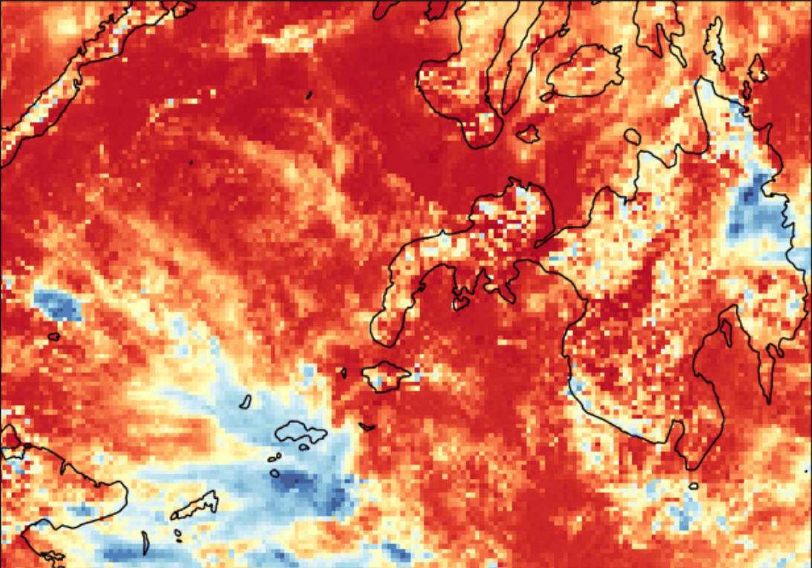
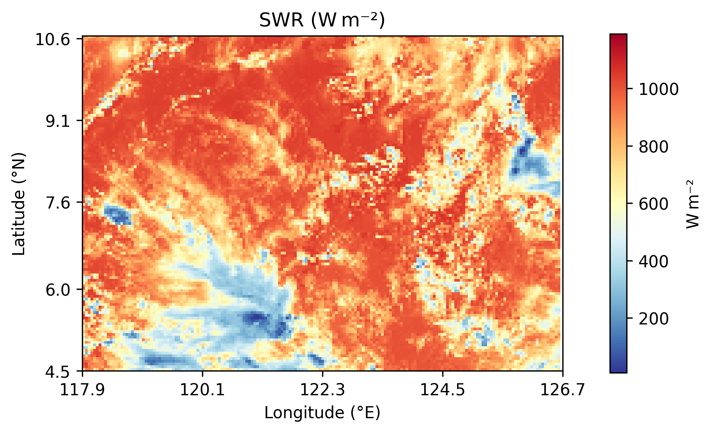
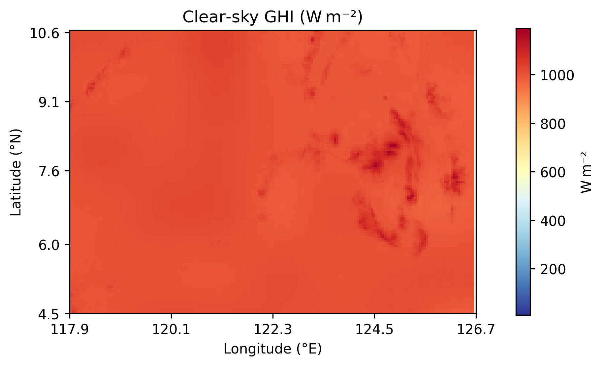
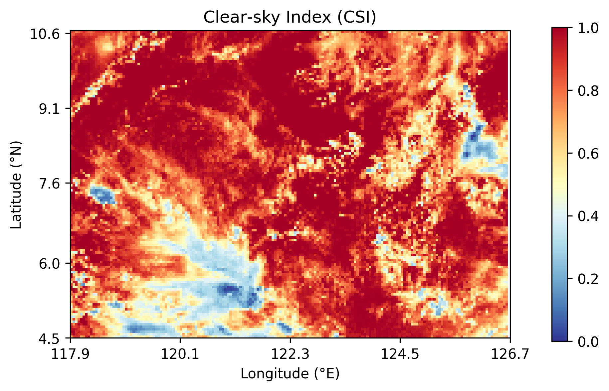
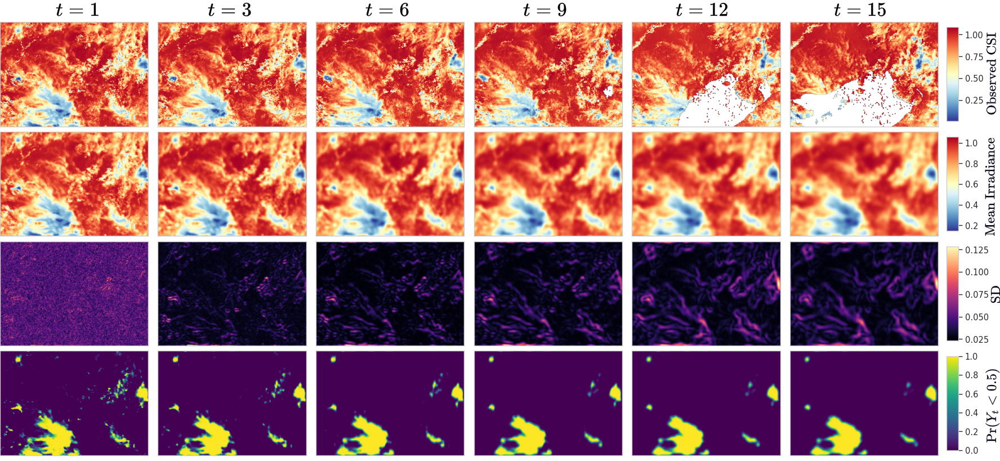
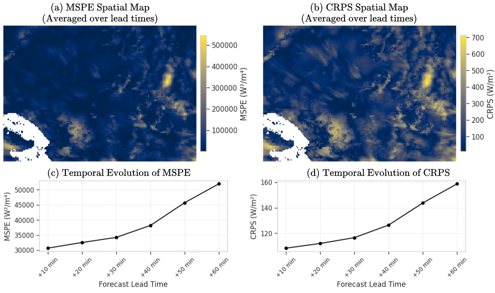
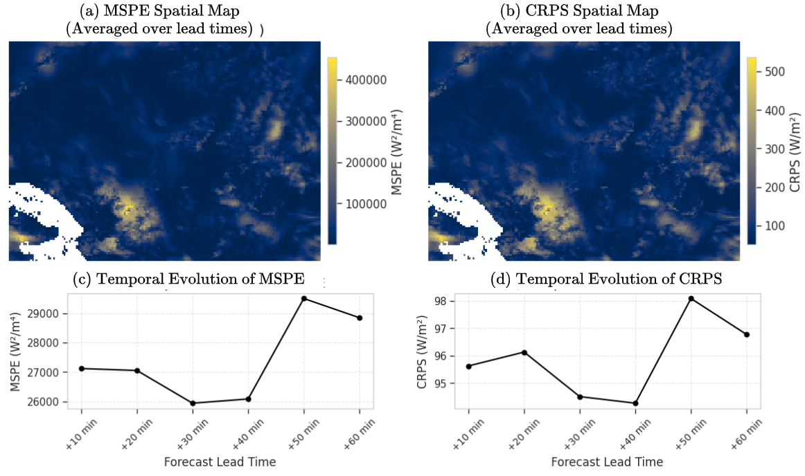
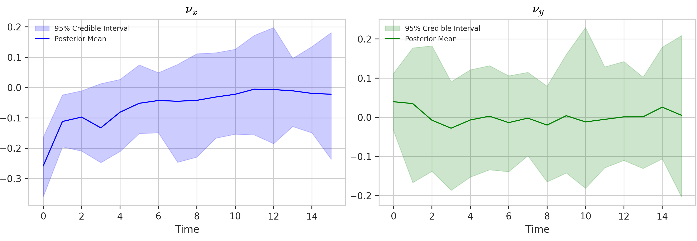

A solar forecast can be wrong in two different ways: it can miss how much sunlight will arrive, or it can miss where the drop will happen.

For grid operations, that second mistake matters because cloud shadows move across space, not just through time.

Solar power forecasting is often described as a time-series problem. That is only partly true. Solar radiation is also a **moving spatial field**. A cloud shadow does not appear independently at each location. It forms, moves, spreads, weakens, and sometimes disappears. If we forecast each pixel or site separately, we lose the structure that makes the process physically interpretable.

That was the main idea behind this project: build a Bayesian dynamic spatiotemporal model for short-term probabilistic forecasting of solar radiation fields.

The goal was not just to ask:

> What will solar radiation be 10 or 30 minutes from now?

The more useful question was:

> Where might solar radiation drop, how soon, and how uncertain is that forecast?

In short:

- The problem was high-dimensional: each satellite frame had 21,824 spatial cells.
- The model treated solar radiation as a latent field with advection-diffusion dynamics.
- The clearest result was that clear-sky index normalization reduced probabilistic forecast error in this case study.

Project link: [AD-GEnKS Adaptive MCMC](https://github.com/ajhoneslacubtan/AD-GEnKS-AdaptiveMCMC)

## The Case Study

I worked with Himawari-9 AHI Level-2 short-wave radiation (SWR) v2.1 from JAXA P-Tree over Mindanao, Philippines. The product represents instantaneous downwelling short-wave flux on a horizontal surface, commonly treated as global horizontal irradiance (GHI). The data had a 5 km spatial resolution and 10-minute temporal resolution. Each image covered a grid of:

```text
124 x 176 = 21,824 spatial cells
```

The real-data experiment used April 4, 2025, with training from 11:00-13:20 PST and evaluation from 13:30-14:20 PST. This is important: the results should be read as a proof of concept on one region and one short validation window, not as a universal benchmark for solar forecasting.

{fig-alt="Short-wave radiation field over Mindanao showing cloudy and clear-sky regions."}

The map already shows the core difficulty. Solar radiation is not uniform. Cloud systems create sharp spatial differences, and those differences can change within minutes.

## Raw Sunlight Is Not Always the Best Modeling Target

The first obvious target is SWR itself: the estimated incoming solar radiation at the surface, measured in W/m².

But raw SWR mixes at least two effects:

- The predictable geometry of the sun, such as time of day and solar angle.
- The harder part: cloud-driven attenuation.

To separate these, I also modeled the **clear-sky index** (CSI):

```text
CSI = observed SWR / Ineichen-Perez clear-sky GHI
```

The clear-sky irradiance is what we would expect under cloud-free conditions. I computed it using the Ineichen-Perez clear-sky model, with the resulting CSI clipped to a practical range before modeling. Dividing by clear-sky GHI turns the problem into a relative measure: how much of the expected sunlight actually reached the surface?

::: {layout-ncol=3}
{fig-alt="Observed short-wave radiation over Mindanao at 12:00 PST, showing cloud-driven spatial variation."}

{fig-alt="Modeled clear-sky irradiance over Mindanao at 12:00 PST."}

{fig-alt="Clear-sky index over Mindanao at 12:00 PST, showing relative cloud attenuation."}
:::

This turned out to be one of the most important lessons from the project. Modeling raw radiation forces the model to handle both the daily solar cycle and cloud variability. Modeling CSI removes much of the predictable solar trend, so the model can focus more directly on cloud-driven changes.

## Why I Modeled a Field, Not Independent Pixels

The model used a Bayesian dynamic spatiotemporal framework. The latent field represented the underlying irradiance or transmissivity pattern, while the satellite data were treated as noisy observations of that field.

The process model was motivated by an advection-diffusion idea:

- **Advection** moves cloud-shadow patterns across the map.
- **Diffusion** smooths or spreads local variation.
- **Process noise** captures changes the model cannot explain.

Instead of starting with the stochastic partial differential equation, the practical intuition is simpler:

```text
next field = weighted neighboring pixels + unexplained change
```

Each grid cell at the next time step is influenced by its current value and its immediate neighbors: left, right, up, and down. That five-point neighborhood makes the model physically motivated while keeping the computation manageable.

The advection parameters should not be interpreted as direct wind measurements. They are better understood as inferred transport proxies: they describe how irradiance or cloud-shadow patterns appear to move in the satellite field.

## Why Bayesian?

A deterministic forecast gives one map. A Bayesian forecast gives a distribution of possible maps.

That distinction matters because solar planning is a risk problem. Operators do not only need the expected amount of sunlight. They also need to know where the forecast is uncertain and where low irradiance is plausible.

The posterior output can be summarized in several ways:

- Posterior mean: the model's best estimate of the latent field.
- Posterior standard deviation: where the model is more or less uncertain.
- Predictive samples: possible future radiation fields.
- Threshold probabilities: for example, the posterior probability that latent CSI falls below 0.5.

{fig-alt="Posterior summaries for the latent clear-sky index field over time, including uncertainty and low-CSI probability maps." column=page}

This is the practical advantage of the Bayesian framing. The output is not just a cleaned-up map. It is a map plus a measure of how much trust to place in different parts of that map. This connects directly to a broader point I wrote about in [Forecasting Uncertainty: Why Prediction Intervals Matter](../forecasting-uncertainty/index.qmd): a useful forecast should communicate risk, not only an expected value.

## Raw SWR Forecasts Worked, But Only for Short Horizons

The raw SWR model captured broad spatial patterns and produced reasonable short-term forecasts. But error increased with lead time, especially beyond about 30 minutes.

That was expected. Tropical cloud systems can evolve quickly, and a simple linear advection-diffusion structure cannot fully capture cloud formation, dissipation, and nonlinear convective behavior.

{fig-alt="Raw SWR forecast evaluation showing higher MSPE and CRPS near cloud edges and increasing error with forecast lead time." column=page}

The direct SWR model was useful mainly at very short horizons. It preserved broad spatial structure, but uncertainty and error grew quickly near cloud boundaries. Quantitatively, its overall error was:

```text
39,517 W²/m⁴
```

and an overall CRPS of about:

```text
129.1 W/m²
```

Those numbers are useful, but the spatial maps are just as important. They show where the model struggled: cloud edges, coastlines, and dynamically changing regions.

## The Main Lesson: CSI Made the Problem Easier

The CSI model performed better after converting predictions back to the SWR scale for evaluation.

Across the tested forecast horizons, CSI-based forecasts achieved roughly:

```text
MSPE: 27,000-29,000 W²/m⁴
CRPS: 95-98 W/m²
```

That was substantially better than the direct SWR model in this case study.

{fig-alt="CSI forecast evaluation showing lower MSPE and CRPS than the raw SWR model after conversion back to SWR scale." column=page}

The reason is not that CSI is magically better for every solar forecasting problem. The more defensible lesson is narrower:

> In this experiment, CSI normalization made the target more stable by removing much of the deterministic solar-angle pattern, allowing the dynamic model to focus more on cloud-driven variability.

That made the model easier to estimate and improved short-term predictive performance.

## What the Model Appeared to Learn About Motion

The posterior advection estimates suggested mostly westward transport early in the fitting window, weakening toward more neutral movement over time. North-south movement was weaker and more uncertain.

{fig-alt="Posterior trajectories for inferred advection parameters in the CSI model."}

This interpretability was useful. It gave the model a way to express not only expected radiation levels but also how cloud-shadow patterns appeared to move.

Still, this should not be overclaimed. These parameters were inferred from irradiance fields. They were not validated against measured wind vectors.

## The Computational Problem Was Real

The hard part was not only the model. It was inference.

The latent field had 21,824 spatial cells per time step. Exact Bayesian smoothing over that many locations is not practical with standard state-space methods.

I used an approximate Bayesian inference pipeline rather than exact smoothing. The key idea was to update a large ensemble of possible spatial fields, then sample uncertain model parameters around those field estimates. This made the problem computationally feasible, though not yet real-time.

The final pipeline used an ensemble size of 100 and 2,000 Gibbs-EnKS iterations, with 1,000 discarded as burn-in and every second draw retained. On modest CPU hardware, the full run took about 3-4 hours.

That means the model was not a real-time operational system. A more accurate description is **quasi-operational prototype**. It showed that high-dimensional Bayesian inference was feasible on realistic spatial fields, but further engineering would be needed for production deployment.

## What I Would Do Differently Next

The project answered a narrow question, but it also exposed the next set of problems.

First, I would test more days, seasons, and cloud regimes. One day over Mindanao is not enough to establish general performance.

Second, I would add ground-station validation. The Himawari-9 product is a satellite retrieval, not ground truth.

Third, I would relax some of the model assumptions. The model used linear dynamics, isotropic diffusion, fixed/tuned observation and state-innovation variances, and immediate-neighbor spatial dependence. Those choices helped make inference tractable, but they are simplifications.

Fourth, I would add external meteorological information. Cloud-motion vectors, numerical weather prediction outputs, aerosol information, or explicit solar-elevation dynamics could improve longer-horizon forecasts.

Finally, I would work on faster inference. A 3-4 hour Bayesian pipeline is useful for research, but not enough for live 10-minute operational cycling.

## Takeaway

This model did not solve solar forecasting.

What it showed was more specific: for this Mindanao case study, a physics-informed Bayesian spatiotemporal model could produce spatially coherent, uncertainty-aware solar forecasts, and the clear-sky index made the problem noticeably easier than modeling raw solar radiation directly.

The most useful forecasting window was short, around the first 30 minutes. Beyond that, cloud dynamics became harder to track with the model's assumptions.

As a modeling project, the value was not only the forecast itself but the workflow: transform the target, encode physical structure, quantify uncertainty, and be explicit about where the model stops being reliable.

For me, the main lesson was methodological:

> In environmental forecasting, the preprocessing step, the physical structure of the model, and the uncertainty output are not separate details. They determine whether the forecast is useful.

The implementation is available in the [AD-GEnKS Adaptive MCMC repository](https://github.com/ajhoneslacubtan/AD-GEnKS-AdaptiveMCMC).
